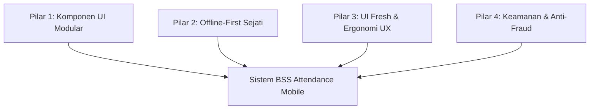
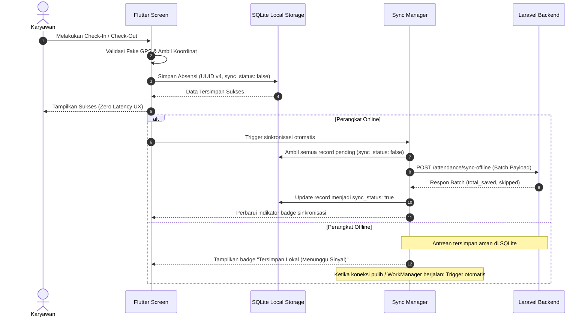
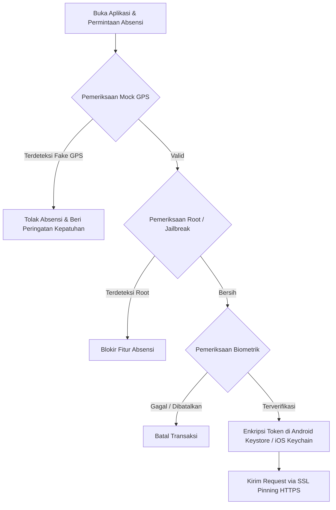
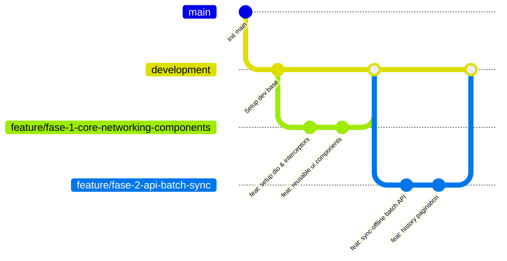

# Blueprint & Rencana Pengembangan BSS Attendance Mobile

Dokumen ini berisi cetak biru arsitektur, hasil analisis menyeluruh terhadap kode Flutter `d:\bss-attendance-mobile`, pemetaan kontrak API backend `C:\laragon\www\bss-attendance-be\Absensi BSS 1`, serta rencana strategis pengembangan bertahap (*phase-by-phase*). Dokumen ini mengedepankan **Desain UI Fresh & Human-Crafted (Anti-AI Slop)**, **Desain Berbasis Komponen (Reusable Components)**, **Arsitektur Offline-First Sejati**, **Keamanan Tingkat Tinggi (Mobile Security Hardening)**, serta **SOP Git Workflow Bertahap**.

---

## 1. Ringkasan Eksekutif & Scope Analisis

Aplikasi **BSS Attendance Mobile** dirancang untuk mencatat kehadiran karyawan operasional dan lapangan PT BSS yang bertugas di kantor pusat maupun di lokasi site proyek dengan kendala jaringan internet (sering offline / sinyal tidak stabil).

### Kondisi Saat Ini (Current State):
- **Arsitektur**: Clean Architecture dasar (`data`, `domain`, `presentation`) dengan `Provider` sebagai state management.
- **Kelemahan Kritis yang Ditemukan**:
  1. **Base URL Tidak Sesuai**: Di kode tertulis `http://attendance-be.test/api`, sedangkan backend menggunakan `http://bss-attendance-be.test/api/`.
  2. **Batch Sync Offline Belum Digunakan**: Backend sudah menyediakan endpoint performan tinggi `POST /attendance/sync-offline` (batch), tetapi Flutter masih melakukan loop request satu per satu ke `/attendance/save`.
  3. **Format UUID Tidak Valid**: ID klien masih dibuat secara string manual `${timestamp}_${userId}`, padahal backend memvalidasi `'attendances.*.uuid' => 'required|uuid'`.
  4. **Penyimpanan Plain Text**: Kredensial dan token disimpan di `SharedPreferences` tanpa enkripsi.
  5. **Tidak Ada Anti-Mock Location**: Karyawan dapat memalsukan koordinat absensi menggunakan Fake GPS.
  6. **UI Belum Terstandarisasi dalam Komponen Modular**: Banyak komponen UI ditulis redundan pada tiap screen.
  7. **Offline-First Belum Sempurna**: Data history dan today status masih sangat bergantung pada ketersediaan koneksi internet saat screen dibuka.

---

## 2. Pemetaan Lengkap API Backend (Laravel Sanctum)

Berdasarkan spesifikasi OpenCollection di `C:\laragon\www\bss-attendance-be\Absensi BSS 1`:

| Endpoint | Method | Auth | Payload / Request | Respon Sukses & Catatan Backend |
|---|---|---|---|---|
| `/auth/login` | POST | Public | `email`, `password` | Token Sanctum (`plainTextToken`) + objek user. Validasi email format & min password 8 karakter. |
| `/auth/logout` | POST | Bearer | - | Menghapus token user di server (`tokens()->delete()`). |
| `/user` | GET | Bearer | - | Mengembalikan data profil user terautentikasi terkini. |
| `/attendance/today` | GET | Bearer | - | Status hari ini: `checked_in`, `checked_out`, `can_checkin`, `can_checkout`, serta objek `checkin` & `checkout`. |
| `/attendance/save` | POST | Bearer | `uuid` (opsional), `type` (`checkin`\|`checkout`), `timestamps`, `latitude`, `longitude`, `location_name` | Database transaction + row locking (`lockForUpdate`). Menolak jika sudah absensi tipe yang sama pada tanggal tersebut. |
| `/attendance/history` | GET | Bearer | Query: `start_date`, `end_date`, `month`, `year`, `type`, `per_page` | Mendukung filter tanggal/bulan/tipe dan pagination otomatis Laravel. |
| `/attendance/sync-offline` | POST | Bearer | `attendances`: Array of `{ uuid, type, timestamps, latitude, longitude, location_name }` | **Batch Transaction Atomik**. Otomatis sorting kronologis, deduplikasi UUID, pencegahan dobel record. Mengembalikan `total_received`, `total_saved`, `total_skipped`, dan detail array `skipped`. |

---

## 3. Filosofi Desain UI/UX: Fresh, Human-Crafted & Anti-"AI Slop"

UI aplikasi lapangan tidak boleh terlihat seperti template generik kecerdasan buatan (*AI slop*) yang identik dengan:
- Gradien ungu-biru mengambang tanpa makna visual (*gradient soup*).
- Ikon emoji berserakan dan kartu-kartu kosong yang tidak bernilai informasi.
- Kontras warna rendah yang tidak terbaca di bawah terik sinar matahari lapangan.
- Elemen mengambang tanpa struktur tata letak fungsional.

### Prinsip Desain BSS Attendance:
1. **Industrial Modern & High Utility**:
   - Palet warna berkarakter industri konstruksi/proyek: *Deep Slate Navy* (`#0F172A`) sebagai warna pondasi, *Steel Blue* (`#1E40AF`) sebagai aksen primer, *Safety Amber* (`#F59E0B`) untuk check-out, dan *Emerald Pine* (`#059669`) untuk status kehadiran valid.
   - Batas permukaan tegas (hairline 1px border `border: Border.all(color: Colors.grey.shade200)`) yang memisahkan tiap section dengan jelas, bukan bayangan kabur yang buram.
2. **Keterbacaan Lapangan & Tabular Figures**:
   - Jam kerja digital menggunakan angka tabular monospaced (`FontFeature.tabularFigures()`) agar angka tidak bergeser atau bergetar setiap detik.
   - Ukuran target sentuh minimal 48x48 dp untuk kemudahan interaksi satu tangan saat memakai perlengkapan kerja.
3. **Mikrokopi Manusiawi & Jelas**:
   - Bahasa lugas, profesional, dan natural (contoh: *"Presensi Masuk"*, *"Presensi Pulang"*, *"Site BSS - Sektor Barat"*, *"3 antrean tersimpan lokal"*).
4. **Sentuhan Taktil (Haptic Feedback)**:
   - Setiap aksi penting (geser kartu absensi, segarkan lokasi, filter riwayat) memberikan sensasi getaran haptik presisi dari perangkat (`HapticFeedback.mediumImpact()`).

---

## 4. Empat Pilar Utama Pengembangan Sistem



---

### Pilar 1: Desain Berbasis Komponen (Reusable Component Library)

Seluruh UI dipecah menjadi komponen independen di direktori `lib/presentation/components/`:

```text
lib/presentation/components/
├── buttons/
│   ├── app_button.dart               # Tombol aksi fleksibel (primary, secondary, danger, loading)
│   ├── swipe_action_button.dart      # Tombol geser interaktif (Swipe-to-Confirm) anti-salah pencet
│   └── app_icon_button.dart          # Tombol ikon berseragam dengan respons haptik
├── inputs/
│   ├── app_text_field.dart           # Input field elegan dengan label mengambang, clear button, & error handling
│   └── app_search_bar.dart           # Input pencarian riwayat absensi cepat
├── cards/
│   ├── hero_attendance_card.dart     # Kartu utama check-in/out dengan pulse animasi & jam live
│   ├── location_info_card.dart       # Kartu detail GPS, akurasi meter, dan status geofence
│   ├── attendance_history_card.dart  # Kartu item riwayat kehadiran dengan badge status sync
│   └── stat_summary_card.dart        # Kartu statistik jam kerja bulanan & kehadiran
├── feedback/
│   ├── offline_status_banner.dart    # Sticky banner atas: "Mode Offline" / "Menyinkronkan X data..."
│   ├── empty_state_view.dart         # Tampilan kosong informatif dengan ilustrasi & pesan ramah
│   ├── error_state_view.dart         # Tampilan error jaringan / GPS dengan tombol Retry cepat
│   └── app_loading_overlay.dart      # Dialog transparan pemrosesan aman
└── dialogs/
    ├── app_bottom_sheet.dart         # Bottom sheet standar untuk filter tanggal riwayat
    └── attendance_result_sheet.dart  # Pop-up konfirmasi ringkasan kehadiran pasca-absensi
```

---

### Pilar 2: Arsitektur Offline-First Sejati (Local-First Pattern)

Prinsip: **Aplikasi tidak pernah memblokir karyawan hanya karena ketiadaan sinyal internet**. Karyawan tetap bisa check-in, check-out, dan membuka riwayat kehadiran kapan saja.



#### Spesifikasi Teknis:
1. **SQLite Database Lokal (`sqflite`)**:
   - Tabel `attendances` menyimpan record lengkap beserta status sinkronisasi, alasan skip server, dan koordinat.
2. **Standard UUID v4**:
   - Seluruh record absensi lokal langsung diberikan UUID v4 (`package:uuid`) yang valid sebelum disimpan.
3. **Batch Auto-Sync Otomatis**:
   - Memanggil `POST /attendance/sync-offline` saat internet pulih (via stream `ConnectivityPlus`). Mengirim seluruh antrean sekaligus dalam satu transaksi database atomik.
4. **Background Sync (`workmanager`)**:
   - Menjalankan sinkronisasi berkala di latar belakang meskipun aplikasi ditutup.
5. **Offline Caching Data Pengguna**:
   - Data profil dan ringkasan kehadiran disimpan di database lokal sehingga saat aplikasi dibuka offline, tidak ada layar kosong atau pesan putus koneksi.

---

### Pilar 3: UI Modern & Ergonomi UX yang Mempermudah Absensi

1. **Hero Attendance Card dengan Jam Digital Real-time**:
   - Jam digital besar yang berjalan per detik dilengkapi tanggal resmi Indonesia.
   - Tampilan status hari ini langsung berubah dinamis:
     - *Belum Presensi*: Tombol geser hijau "Geser untuk Presensi Masuk".
     - *Sedang Bekerja*: Ticker durasi kerja berjalan ("Bekerja 4 jam 15 menit") & tombol oranye "Geser untuk Presensi Pulang".
     - *Selesai*: Kartu ringkasan harian (Masuk 08:00 WIB • Pulang 17:05 WIB).
2. **Swipe-to-Confirm**:
   - Mencegah tombol terpencet tidak sengaja di dalam saku celana atau tas.
3. **Kartu Lokasi & Geofence Interaktif**:
   - Menampilkan nama site proyek BSS, koordinat, dan status radius ("Dalam Radius Site" atau "Luar Radius").
   - Dilengkapi tombol satu-ketuk **"Segarkan GPS"** jika akurasi belum optimal.

---

### Pilar 4: Keamanan Tingkat Lanjut (Mobile Security Hardening)



1. **Anti-Mock Location & Deteksi Fake GPS**:
   - Pemeriksaan `position.isMocked` bawaan geolocator.
   - Pengecekan status Mock Provider di developer options Android via `safe_device`.
   - Validasi batas deviasi waktu antara perangkat dan server.
2. **Penyimpanan Terenkripsi (Secure Storage)**:
   - Migrasi token Sanctum ke `flutter_secure_storage` (**Android Keystore AES-GCM** & **iOS Keychain**).
3. **Deteksi Root / Jailbreak**:
   - Pengecekan binary `su`, Magisk, SuperSU, Cydia, dan Frida.
4. **Network Security & SSL Pinning**:
   - Certificate pinning pada Dio client dan menonaktifkan cleartext traffic di release build.
5. **Autentikasi Biometrik**:
   - Verifikasi sidik jari/Face ID opsional sebelum presensi dieksekusi.

---

## 5. Standard Operasional Git Workflow Bertahap

Untuk menjaga stabilitas kode dan riwayat perubahan yang rapi, pengembangan dilakukan **secara bertahap per fase** dengan aturan git sebagai berikut:



### Aturan Eksekusi Git:
1. **Base Branch**: Seluruh pekerjaan bermuara di branch `development`. Branch `main` hanya untuk kode siap rilis.
2. **Branch Per Fase**: Saat memulai fase baru, buat branch baru dari `development` dengan format penamaan:
   - Fase 1: `feature/fase-1-core-networking-components`
   - Fase 2: `feature/fase-2-api-batch-sync`
   - Fase 3: `feature/fase-3-sqlite-offline-engine`
   - Fase 4: `feature/fase-4-security-antifraud`
   - Fase 5: `feature/fase-5-modern-ui-ux`
   - Fase 6: `feature/fase-6-testing-hardening`
3. **Atomic Commit**: Selalu lakukan commit berkala pada setiap penyelesaian sub-fitur dengan format Conventional Commits (`feat:`, `fix:`, `refactor:`, `style:`, `test:`).
4. **Merge & Transisi**:
   - Setiap fase selesai dikembangkan dan diverifikasi bebas error lint/build, branch fase di-merge ke `development`.
   - Lanjutkan ke fase berikutnya dengan membuat branch baru dari `development`.

---

## 6. Rencana Tahapan Eksekusi Bertahap (Sprint Roadmap)

### Fase 1: Fondasi Core, Networking & Pustaka Komponen Modular
- **Branch**: `feature/fase-1-core-networking-components`
- **Tugas**:
  - Setup environment config (`.env`) & Base URL dinamis.
  - Setup HTTP Client berbasis `Dio` + `AuthInterceptor` + `RetryInterceptor`.
  - Pembuatan generator UUID v4.
  - Implementasi pustaka komponen modular (`AppButton`, `SwipeActionButton`, `AppTextField`, `LocationInfoCard`, `HeroAttendanceCard`, `OfflineStatusBanner`).
- **Verifikasi**: Widget preview & unit test networking.
- **Merge**: Merge ke `development`.

### Fase 2: Integrasi Lengkap Seluruh API Backend & Batch Sync
- **Branch**: `feature/fase-2-api-batch-sync`
- **Tugas**:
  - Implementasi `POST /attendance/sync-offline` (batch processing).
  - Integrasi `GET /user` untuk auto-refresh profil.
  - Penyempurnaan `GET /attendance/history` dengan query params (`start_date`, `end_date`, `type`) dan response pagination.
  - Penyelarasan response status `GET /attendance/today`.
- **Verifikasi**: Integrasi API lulus uji request-response sesuai spek Bruno/OpenCollection.
- **Merge**: Merge ke `development`.

### Fase 3: Arsitektur Offline-First & SQLite Local Engine
- **Branch**: `feature/fase-3-sqlite-offline-engine`
- **Tugas**:
  - Setup database relasional SQLite (`sqflite`) dengan skema tabel `attendances` & `cached_user`.
  - Implementasi `SyncManager`: otomatis mendeteksi koneksi pulih via `ConnectivityPlus` dan mengeksekusi flush batch sync.
  - Background task berkala via `workmanager`.
- **Verifikasi**: Uji coba airplane mode (check-in offline -> sinyal aktif -> otomatis tersinkronisasi ke backend).
- **Merge**: Merge ke `development`.

### Fase 4: Keamanan Aplikasi (Mobile Security Hardening)
- **Branch**: `feature/fase-4-security-antifraud`
- **Tugas**:
  - Implementasi Anti-Mock Location (pengecekan `position.isMocked` & developer options mock provider via `safe_device`).
  - Migrasi token ke `flutter_secure_storage` (Android Keystore / iOS Keychain).
  - Pengecekan perangkat root/jailbreak.
  - Integrasi autentikasi biometrik via `local_auth`.
  - Konfigurasi SSL Pinning & pelarangan cleartext traffic.
- **Verifikasi**: Uji penetrasi lokal (Fake GPS injection test, validasi Keystore).
- **Merge**: Merge ke `development`.

### Fase 5: Redesain UI Modern & Ergonomi UX Lapangan
- **Branch**: `feature/fase-5-modern-ui-ux`
- **Tugas**:
  - Redesain `HomeScreen`: Jam digital live dengan tabular figures, kartu status kerja dinamis, swipe action button, dan geofence status.
  - Redesain `HistoryScreen`: Filter rentang tanggal (date picker), filter tipe absensi, infinite scroll, badge status sync jelas.
  - Redesain `ProfileScreen`: Ringkasan statistik jam kerja bulanan, status perangkat, dan tombol manual sync.
  - Penerapan tema Material 3 modern dan haptic feedback.
- **Verifikasi**: Pengujian visual di berbagai ukuran layar dan responsivitas interaksi geser.
- **Merge**: Merge ke `development`.

### Fase 6: Testing Menyeluruh, Hardening & Persiapan Rilis
- **Branch**: `feature/fase-6-testing-hardening`
- **Tugas**:
  - Pengujian end-to-end menyeluruh (unit test, widget test, scenario offline/online).
  - Build optimasi release dengan R8/ProGuard dan code obfuscation (`--obfuscate --split-debug-info`).
- **Verifikasi**: APK release siap uji coba lapangan (*pilot test*).
- **Merge**: Merge ke `development` dan `main`.

---

## 7. Rekomendasi Dependensi Lengkap (`pubspec.yaml`)

```yaml
dependencies:
  flutter:
    sdk: flutter

  # UI, Typography & Icons
  cupertino_icons: ^1.0.8
  intl: ^0.20.2
  google_fonts: ^6.2.1

  # State Management & Service Locator
  provider: ^6.1.5+1
  get_it: ^8.0.3

  # Networking & Environment
  dio: ^5.7.0
  flutter_dotenv: ^5.2.1

  # Location, Sensors & Feedback
  geolocator: ^14.0.3
  geocoding: ^4.0.0

  # Offline Storage & Background Worker
  sqflite: ^2.4.1
  path: ^1.9.1
  connectivity_plus: ^7.1.1
  uuid: ^4.5.1
  workmanager: ^0.5.2

  # Security & Biometrics
  flutter_secure_storage: ^9.2.4
  local_auth: ^2.3.0
  safe_device: ^1.1.4

dev_dependencies:
  flutter_test:
    sdk: flutter
  flutter_lints: ^6.0.0
```
